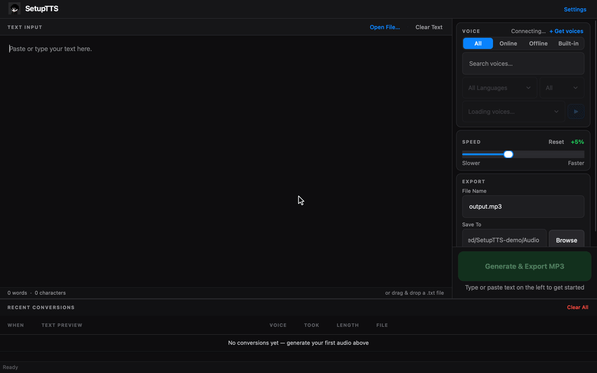
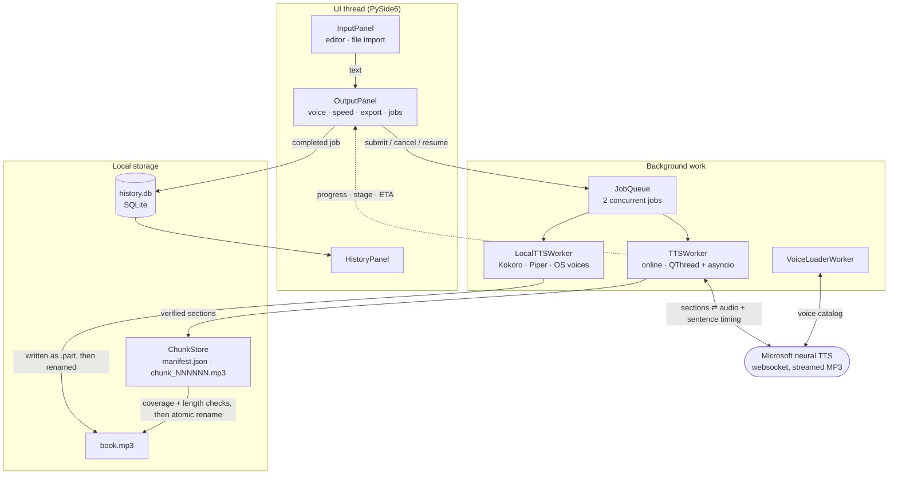
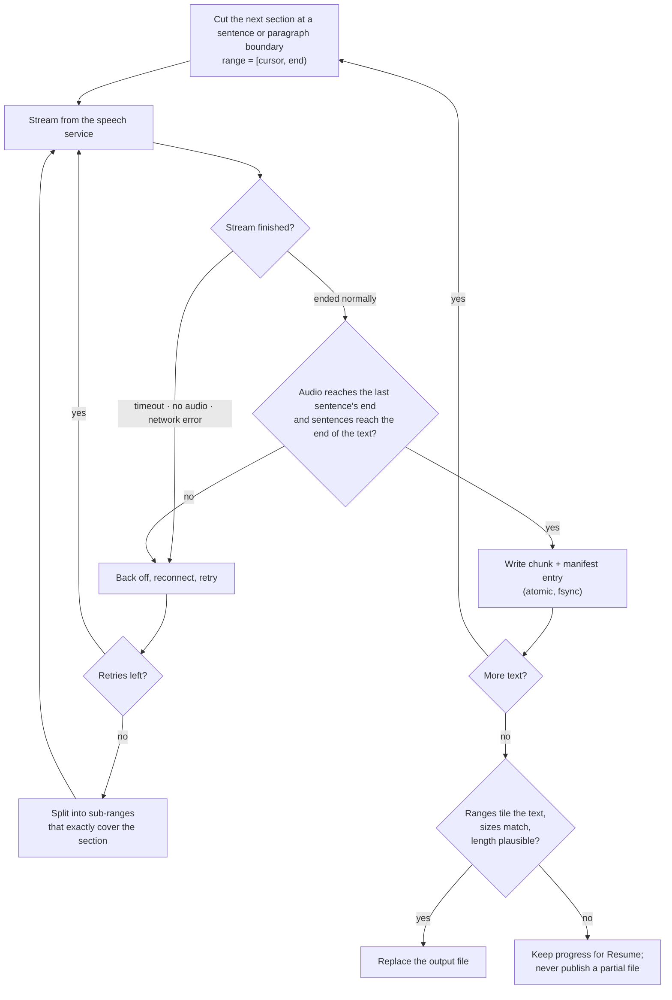

<p align="center">
  
</p>

<h1 align="center">SetupTTS</h1>

<p align="center">
  Turn text into MP3 audio on macOS and Windows: online Microsoft neural voices,
  lifelike offline voices, and your computer's built-in voices.<br>
  Built to finish 30-hour audiobooks without losing a sentence.
</p>

<p align="center">
  <a href="../../releases/latest"></a>
  <a href="../../actions/workflows/build.yml"></a>
  
  
  
</p>

<p align="center">
  
</p>

---

## Download

**[Latest release →](../../releases/latest)**

| Platform | File |
|---|---|
| macOS 15+ (Apple Silicon) | `SetupTTS-macOS.dmg`: drag to Applications. `SetupTTS-macOS.zip` is the same app. |
| Windows 10/11 (64-bit) | `SetupTTS-Windows-Installer.exe`, or `SetupTTS-Windows-Portable.zip` (no install) |

Nothing else to install: Python, the speech engines and the MP3 encoder are inside the app.
The apps are not code-signed, so the first launch needs one extra click:
macOS **System Settings ▸ Privacy & Security ▸ Open Anyway**; Windows **SmartScreen ▸ More info ▸ Run anyway**.

---

## Voices

One picker, four tabs: **All · Online · Offline · Built-in**.

| Kind | Internet | Voices | Notes |
|---|---|---|---|
| **Online**: Microsoft neural | Needed | 300+ in 70+ languages | Best quality; speed depends on the service |
| **Offline HD**: [Kokoro-82M](https://huggingface.co/hexgrad/Kokoro-82M) | Only to download | 41 in 7 languages: US and UK English, Spanish, French, Hindi, Italian, Brazilian Portuguese | Most lifelike offline voices. First voice downloads the shared 325 MB model, then under 1 MB per voice |
| **Offline**: [Piper](https://github.com/rhasspy/piper) | Only to download | 1 included, ~170 more in ~50 languages | Lighter (20–75 MB per voice) |
| **Built-in**: your OS | No | Every installed system voice | Windows SAPI / OneCore voices; macOS system voices |

Offline voices are downloaded in **+ Get voices**, which lists Kokoro first, best-rated first, with a filter for Kokoro HD or Piper.
Every download is pinned to a fixed revision and checked by SHA-256 before it is installed.

---

## Using it

1. **Add text.** Type or paste, **Open File…**, or drop a `.txt` file on the editor. UTF-8, UTF-16 and ANSI are detected.
2. **Pick a voice.** Choose a tab, search by name or language, filter by language and gender. **▶** plays a sample.
3. **Set the speed.** −50% to +100%. **Reset** returns to normal.
4. **Export.** Set a file name and folder, then **Generate & Export MP3**.

Jobs run in the background. **Active Jobs** shows each job's stage, progress, speed and time left. Up to two jobs run at once.
Finished files go to **Recent Conversions**: double-click to play, or right-click to show the file in its folder, copy its path or remove it from the list.
If a job stops (app closed, crash, no internet), **Resume Unfinished Job** continues where it stopped.

| Shortcut (⌘ on macOS, Ctrl on Windows) | Action |
|---|---|
| ⌘/Ctrl + O | Open a text file |
| ⌘/Ctrl + Enter | Generate MP3 |
| ⌘/Ctrl + , | Settings |

**Settings** sets the default save folder, auto-matching the voice to the text's language, and NVIDIA GPU support (Windows). It also has the logs.

---

## How it works

The hard part of long jobs is completeness, not speech. A book is hundreds of requests, and any one of them can time out, return nothing, or end early without an error. SetupTTS treats each of those as normal and never saves a file it cannot prove is complete.

**Online voices**
- **Truncation detection.** The streaming client can end quietly when the websocket closes mid-response, returning partial audio as if it were whole. Each section is checked against the service's sentence timing (offset + duration in 100 ns ticks), the byte length of the 48 kbit/s CBR stream, and whether the announced sentences reach the end of the section's text. It was validated on complete streams from 36 voices in 9 languages (no false alarms) and on every cut point of real streams (all detected).
- **Recovery.** Retries use exponential backoff with a fresh connection. A section that keeps failing is split into sub-ranges whose union must equal the original range exactly. If the service is unreachable, the job waits up to 30 minutes for the connection without using up retries.
- **Parallel sections, saved in order.** Up to three sections stream at once. On a test, six 8,600-character sections took 128 s one at a time and 18 s three at a time. Sections are still committed strictly in order. The first section runs alone; any failure drops back to one at a time for two minutes, and HTTP 429 lowers the limit for the rest of the job.

**Offline voices**
- **Kokoro** runs as ONNX on the same onnxruntime and espeak-ng that Piper uses, so it adds no dependencies and behaves the same on macOS and Windows. espeak-ng phonemes are mapped to Kokoro's alphabet. Text is packed into runs of about 100–250 phonemes, the model's best length. The ~0.8 s of padding the model adds around each run is trimmed, and even pauses are put back.
- **Full-precision model.** The half-precision Kokoro model returned silent (NaN) audio for about one passage in four, so the full-precision model is used. A run that still comes back invalid is spoken in two halves instead of being left as a gap.
- **Piper** renders two sentences at a time with the CPU cores split between them (1.75× faster on Ryan high). Long sentences are spoken a clause at a time, which avoids the garbling some voices produce on run-on text.
- **NVIDIA GPU (Windows, beta).** An optional one-time download (~1.3 GB) adds onnxruntime-gpu with NVIDIA's CUDA 13 and cuDNN 9 libraries, every file pinned by SHA-256. In **Automatic** mode a speed check runs in a separate process, so a driver crash cannot take the app down. The card is used only when it is clearly faster. If the card fails mid-job, the job carries on on the processor.

**Every job**
- **Crash-safe staging.** Each finished section is written atomically (temp file, `fsync`, rename, with retries for Windows file locks) to a staging folder. Its manifest records the section's exact `[start, end)` character range and a hash of its text. Resume trusts only the verified contiguous prefix.
- **Fail-closed assembly.** Before the MP3 is written, the ranges must tile the text exactly, every chunk must exist with its recorded size, and the audio length must be plausible for the text. This is checked on a temporary file, so a bad result never replaces a good one.
- **Keeps running.** While a job runs, the computer is kept from idle sleep (`caffeinate` / `SetThreadExecutionState`), and App Nap (macOS) and power throttling (Windows) are held off, so a hidden window keeps full speed.
- **Responsive UI.** Work runs on `QThread` workers with their own `asyncio` loops. The UI thread only receives throttled progress signals.

### Architecture



### Life of one online section



### When something goes wrong

| Problem | What happens |
|---|---|
| Connection drops mid-section | The missing audio is detected and the section is requested again |
| Timeout, DNS failure, empty response | Retry with backoff, then split the section. If it still fails, finished sections are kept and **Resume** is offered |
| Wi-Fi drops or the computer wakes offline | *Waiting for internet connection…*, then it continues on its own (up to 30 min) |
| Laptop lid closed | The computer sleeps. The job pauses and continues after wake |
| App closed or crashed mid-book | Finished sections stay on disk. **Resume Unfinished Job** continues from the first unverified one |
| A Kokoro run returns invalid audio | That part is spoken in two halves instead |
| Disk full or file locked while saving | The job stops with a plain explanation and stays resumable |
| Audio far shorter than the text implies | Your file is left untouched. The suspect audio is saved as `name (incomplete).mp3` |
| Output file already exists | You choose **Keep Both** (`name (2).mp3`) or **Replace** |
| Antivirus HTTPS scanning, company proxy | The system certificate store and system proxy setting are used, so voices still load |
| Second copy launched | The running window comes to the front |

---

## Output and performance

| | Online | Kokoro HD | Piper · Built-in |
|---|---|---|---|
| Format | 24 kHz, 48 kbit/s mono MP3 | 24 kHz, 64 kbit/s mono MP3 | 22 kHz, 64 kbit/s mono MP3 |
| Speed | Set by the service | ~6–7× realtime on Apple M-series | Depends on voice and CPU |
| Memory while speaking | Small | ~1.3 GB (~2.4 GB on 16 GB+ machines, which run two pieces at once) | Up to two runs per voice |

Measured on a MacBook Pro M5: a 1.75-million-character web novel became **29 h 24 min of audio in 3 h 51 min** with Kokoro Heart. Memory stayed flat at 2.4 GB. There was no gap longer than 2 s, and speech recognition on samples matched the text apart from character names.

**Limitations**
- Online voices come from Microsoft's service (the voices behind Edge's Read Aloud), used without an official API agreement, so availability can change.
- Kokoro's Japanese and Chinese voices are not offered: they need pronunciation data the app doesn't include.
- macOS needs version 15 or later on Apple Silicon (required by the bundled Qt). On Windows, GPU support needs an NVIDIA card.

---

## Troubleshooting

**Settings ▸ Logs & Troubleshooting** has **Open Logs Folder**, **Open Current Log**, **Copy Log Path** and **Copy Diagnostic Info**. Error dialogs give a plain explanation, with the technical cause under **Show Details…**.

| | Log file |
|---|---|
| macOS | `~/Library/Logs/SetupTTS/setuptts.log` |
| Windows | `%LOCALAPPDATA%\SetupTTSApp\SetupTTS\Logs\setuptts.log` |

- **"Could not load voices".** Check the internet connection and the computer's date and time, then **Retry**. A log line mentioning `SSL` or `CERTIFICATE` points to a network that intercepts secure traffic.
- **An offline download failed.** In **+ Get voices**, click **Download** again. A partial or damaged file is never installed.
- **Which version am I running?** It is in the window title and at the top of Settings.

---

## Development

<details>
<summary>Setup, tests, builds and releases</summary>

### Run from source

Requires Python 3.12 (3.11 works).

```bash
git clone https://github.com/VijaysinghPuwar/setuptts.git
cd setuptts
python3.12 -m venv .venv
source .venv/bin/activate          # Windows: .venv\Scripts\activate
pip install -r requirements.txt
python main.py
```

`requirements.txt` pins the exact versions the releases are built and tested with: PySide6, edge-tts, aiohttp, piper-tts, onnxruntime, numpy and lameenc.

### Tests

```bash
pip install pytest pytest-qt
QT_QPA_PLATFORM=offscreen pytest -q
```

The suite simulates 12-hour jobs, network outages, sleep and wake, crashes and resume, and includes regression tests that fail on the pre-fix code.
Real-voice stress tests:

```bash
python scripts/stress_voices.py                                      # every voice source, hostile text, speeds
python scripts/stress_voices.py --sources kokoro                     # every Kokoro voice (downloads them)
python scripts/stress_voices.py --text-file book.txt --rate +100%    # passages of a book through many voices
python scripts/stress_longform.py --hours 12 --voice kokoro:af_heart # a 12-hour book through the real job worker
```

Check a packaged build (CI runs this on every artifact):

```bash
dist/SetupTTS.app/Contents/MacOS/SetupTTS --selftest result.json --network --kokoro
```

Re-record the GIF above. This drives the real app with a scripted cursor against a throwaway data folder, and needs ffmpeg:

```bash
python scripts/record_demo.py --data-dir /Users/Shared/SetupTTS-demo --kokoro-from <folder with model.onnx and voices/>
```

### Build

```bash
pip install pyinstaller
./build_macos.sh          # macOS → releases/
.\build_windows.ps1       # Windows (PowerShell) → releases\
```

### Release

1. Set the version in `app/__init__.py` and `pyproject.toml`.
2. Add `release_notes/vX.Y.Z.md`.
3. `git tag vX.Y.Z && git push origin vX.Y.Z`

GitHub Actions then:
- checks that the tag matches the version;
- runs the tests on macOS and Windows;
- builds the DMG, zip, installer and portable app;
- launches every packaged app to check its bundled files, load the voices and speak a verified sample (the Mac app and Windows build also download Kokoro and speak with it);
- publishes the release.

### Project layout

```
app/
├── main.py              QApplication setup, single-instance guard
├── selftest.py          packaged-build self-test (--selftest)
├── config/              settings.json
├── models/              Voice, Job
├── services/            tts_service (online) · kokoro_tts · piper_tts · system_tts
│                        local_tts (routing) · gpu_accel · history_service · tts_quality
├── workers/             job_queue · tts_worker · local_tts_worker · chunk_store · voice_loader
├── ui/                  main_window · panels/ · dialogs/
├── utils/               paths · logging · errors · power (keep-awake) · single_instance
└── assets/              styles/app.qss · icons/
scripts/                 stress tests, demo recorder
tests/                   pytest + pytest-qt
installers/windows.iss   Inno Setup installer
setuptts.spec            PyInstaller (macOS app, Windows onedir)
release_notes/           one file per release, used by CI
.github/workflows/       build, test, self-test and release
```

</details>
